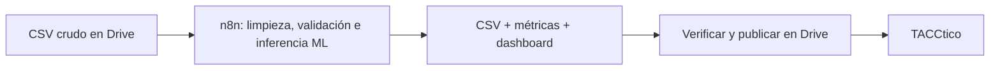

# TACCtico

Compará insumos sin TACC y armá el presupuesto de tu negocio con publicaciones de Mercado Libre Argentina.

**[Abrir la demo](https://tacctico-portafolio-ucn4pkoeemkzx9fowx7ktt.streamlit.app/)** · [Guía de uso](docs/GUIA_USO.md) · [Documentación para la entrega](docs/ENTREGA_GITHUB.md)

## Qué podés hacer

- **Catálogo:** buscar productos y filtrar por insumo y precio.
- **Arma tu presupuesto:** comparar pesos y presentaciones, preparar una lista de compras y descargarla en PDF.
- **Dashboard:** explorar precios y escenarios de ahorro.

La demo contiene **372 publicaciones reales**, con precios capturados el **14/11/2026**. IVA, envío y disponibilidad requieren confirmación; las estimaciones de ahorro no representan compras realizadas. Ver [datos y procedencia](docs/DATOS.md).

## Ejecutar en tu computadora

Con Python 3.12, desde la carpeta del repositorio:

```powershell
python -m venv .venv
.\.venv\Scripts\python.exe -m pip install -r requirements.txt
.\.venv\Scripts\python.exe -m streamlit run app/streamlit_app.py --server.address 127.0.0.1
```

Abrí [la demo local](http://127.0.0.1:8501). En macOS/Linux usá `.venv/bin/python`. No necesitás credenciales ni entrenar el modelo para probar la aplicación.

## Cómo se actualizan los datos



n8n procesa el CSV ya obtenido y publica un lote completo. La aplicación consulta esos resultados y conserva una copia de respaldo si Drive no responde. Abrir la web no ejecuta scraping ni n8n. [Instalación y funcionamiento del flujo](n8n/README.md).

## Modelo entrenado

Random Forest estima una referencia de precio por kg; Isolation Forest aporta señales auxiliares para revisar publicaciones. Las señales no modifican los precios ni deciden las compras. La evaluación reservada obtuvo **R² = 0,527**, con sus límites y propuestas de mejora en el [informe del modelo](docs/MODELO_ML.md).

El mismo modelo se ejecutó en un [actor propio de Apify](actor_apify/README.md), cuyo código y contratos están incluidos.

## Estructura del proyecto

```text
.actor/          Configuración del actor propio
actor_apify/     Fuente Python, Dockerfile y contratos de inferencia
apify/           Referencia del scraper externo
app/             Interfaz, reglas de compra y PDF
colabs/          Notebooks de análisis y entrenamiento
n8n/             Flujos importables, ETL, métricas y modelos
scripts/         Entrenamiento, importación y pruebas
data_public/     Resultados autorizados para la demo
docs/            Guías, evaluación y evidencias
```

## Documentación

| Para consultar | Enlace |
| --- | --- |
| Uso, ejemplos de compra y supuestos del ROI | [Guía de uso](docs/GUIA_USO.md) |
| Dataset, esquema y fuentes | [Datos y procedencia](docs/DATOS.md) |
| Instalación y reproducción de la automatización | [n8n](n8n/README.md) |
| Entrenamiento, evaluación y consumo | [Modelo ML](docs/MODELO_ML.md) |
| Organización del código y comandos de pruebas | [Guía del código](docs/CODIGO.md) |
| Evidencias y estado frente a la consigna | [Entrega](docs/ENTREGA_GITHUB.md) |

Los datos crudos y las credenciales permanecen privados. Las condiciones de uso de las fuentes y dependencias se detallan en [fuentes y licencias](docs/DATOS.md#fuentes-y-licencias).
