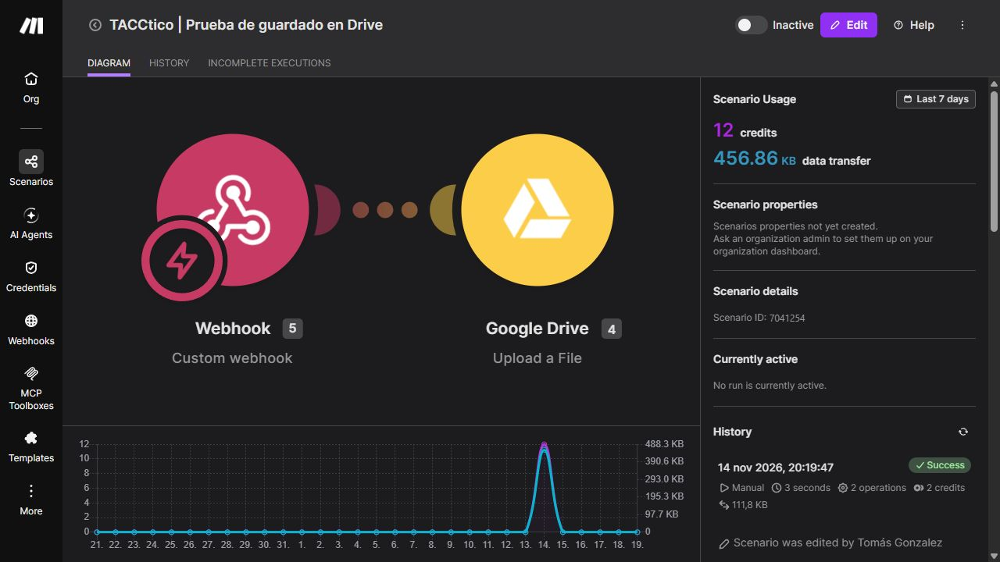
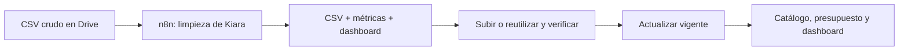

# TACCtico

Compará ofertas de insumos sin TACC y armá el presupuesto de tu negocio con presentaciones completas, cantidades y precios de Mercado Libre Argentina. Incluye catálogo, lista de compras, PDF y el dashboard de abastecimiento de Kiara.

[Abrir TACCtico online](https://tacctico-portafolio-ucn4pkoeemkzx9fowx7ktt.streamlit.app/)

## Entrega y revisión del código

- [Checklist contra la consigna de GitHub](docs/ENTREGA_GITHUB.md), con evidencias y pendientes.
- [Guía para leer el código](docs/CODIGO.md), responsabilidades y verificación del formato.
- [Flujos importables de n8n, código Python e instalación](n8n/README.md).
- [Make: prototipo anterior, captura real e historial](make/README.md).
- [Procedencia de Apify](apify/README.md): scraper externo de karamelo identificado; configuración histórica y fuente documentados por separado.

### Evidencias de automatización


Captura del editor de n8n del 19/11/2026. El código y las plantillas importables están en `n8n/`; durante esta revisión no se ejecutó el flujo.



El prototipo de Make fue reemplazado por n8n. Su captura muestra el escenario inactivo y la ejecución exitosa del 14/11/2026 a las 20:19:47. No se lanzó una corrida nueva.

Se puede consultar sin cuenta. La versión procesada el **23/11/2026**, con el ROI actualizado, tiene **372 publicaciones reales**, con precios de la captura del **14/11/2026**. El análisis estadístico usa **330** publicaciones útiles sin precios atípicos. La fecha de procesamiento no actualiza los precios de la captura.

La interfaz muestra precios en formato argentino, nombres de insumos legibles y «Sin dato» cuando falta información. El catálogo usa una tabla en escritorio y tarjetas paginadas en celular. En el presupuesto, la cantidad aparece antes de los filtros opcionales; la lista queda visible en escritorio y una barra de resumen permite volver a ella en celular. Esa barra conserva el aviso de cargos pendientes.

El encabezado verde y el logo permanecen visibles también en **Dashboard**. Las secciones cambian con un fundido breve de 180 ms y los desplegables usan un puntero de selección, conservando la búsqueda por teclado. La navegación por teclado responde de inmediato y se respeta el movimiento reducido. El dashboard de Kiara, sus datos, gráficos y métricas, y los cálculos del presupuesto conservan su comportamiento.

## Probarlo

El catálogo permite desplegar **Ofertas con precio para revisar**. En **Arma tu presupuesto → Detalle e IVA**, aparece la referencia estimada por kg. Son señales del modelo entrenado con la captura real, sin modificar los precios ni descartar compras. El dashboard de Kiara se conserva.

El [informe de ML](docs/MODELO_ML.md) incluye entrenamiento, prueba reservada, comparación de modelos y consumo. También se entregan el [actor propio de inferencia](actor_apify/README.md), modelos versionados y notebooks de análisis y entrenamiento en `colabs/`. No se necesita entrenar ni introducir claves para usar la web.

1. En **Catálogo**, comprobá las 372 publicaciones. Buscá por título o insumo y escribí un mínimo o máximo de precio. Un extremo vacío no impone límite. Abrí la publicación original para revisar su detalle.
2. En **Arma tu presupuesto → Por cantidad → Peso (kg o g)**, elegí **Polvo hornear**. En **Acotar ofertas → Publicaciones para comparar**, seleccioná `MLA3573151270`, `MLA1824200300` y `MLA3325209494`.
3. En gramos, con `250` se recomienda la presentación de **ARS 3.509,00**. Con `1.000` se recomienda la de **ARS 6.639,00** para cubrir 1 kg. Los importes corresponden a mercadería de la captura.
4. Pulsá **Agregar a la lista** o hacé doble clic en una oferta. Podés sumar varias publicaciones del mismo tipo de insumo y editar sus cantidades por separado. Agregar otra vez la misma publicación actualiza su cantidad. **Vaciar lista** pide confirmación antes de quitar todos los productos, cantidades, IVA y envíos del presupuesto. **Cancelar** o cerrar la pregunta conserva la lista. Revisá presentaciones enteras, peso recibido y sobrante. Completá IVA y envío solo si están confirmados. Descargá el **presupuesto PDF**, con logo, detalle por proveedor, cantidades, importes y enlaces. Si falta un cargo, muestra **Importe conocido** y los pendientes.
5. En **Dashboard**, probá los filtros de insumo, formato, vendedor y envío. Revisá los ejemplos de pan, pizza y budín. Las brechas frente a la mediana son estimaciones, no ahorros observados. Los tiempos, frecuencia y valor por hora son supuestos editables.
6. **Actualizar datos** consulta el último lote completo. Si cambió, comienza una lista vacía para usar sus precios. Si falla, conserva la versión disponible y el presupuesto. La fecha está debajo de la navegación; su ayuda muestra la versión.

Para cantidades usá formato argentino: `1` = un kilo; `1.000` = mil; `1,5` = uno y medio. Las presentaciones sin confirmar no se usan en comparaciones de cantidades. Los precios atípicos quedan fuera de las recomendaciones automáticas. El envío anunciado en la captura no garantiza el costo de envío de un pedido actual.

### ROI del dashboard

El ROI considera el ahorro anual estimado en compras menos el costo anual de datos, dividido por ese costo. Usa el promedio simple del ahorro por lote de las recetas disponibles, multiplicado por los lotes mensuales del escenario y por 12. El ahorro de tiempo se muestra por separado y no aumenta el ROI.

Los valores iniciales son supuestos editables del equipo: **USD 15 por actualización**, **12 actualizaciones al año** y **ARS 1.701 por USD**, equivalentes a **ARS 306.180 anuales**. Los USD 15 provienen del gasto acumulado informado de Apify, incluidas pruebas; usarlos por actualización es un escenario, no un costo recurrente medido. El cambio es una referencia aportada por el equipo, no una cotización en vivo. No se incluyen trabajo, electricidad ni otros costos no cuantificados. Un costo cero muestra el beneficio neto y deja el porcentaje sin calcular; los campos vacíos no se interpretan como cero.

La plantilla de n8n y `metricas.json` conservan los mismos supuestos. Las pruebas de `scripts/test_dashboard_roi.py` comprueban las cuentas, los valores faltantes y la integridad del HTML publicado.

## Planificar una receta por presupuesto

En **Arma tu presupuesto → ¿Cómo querés calcular? → Por presupuesto**, elegí **Pan**, **Pizza** o **Budín** e ingresá cuánto podés gastar en mercadería. **Ajustar receta** permite cambiar los gramos de cada insumo por lote y el máximo de lotes a planificar (20 inicialmente). Un lote es una preparación con esas cantidades; los ejemplos no son recetas completas validadas. Revisá la etiqueta de la premezcla y tu receta para determinar si requiere otros ingredientes.

El plan elige una publicación por insumo y compra presentaciones completas de hasta 5 kg. Excluye publicaciones sin peso confirmado, en revisión o con precio atípico. Muestra lotes cubiertos, importe de mercadería, costo de compra por lote, dinero restante y sobrantes de producto. No mezcla varias publicaciones del mismo insumo para optimizar una receta. La búsqueda usa costos decimales y evita recorrer uno a uno todos los lotes del límite.

Ejemplos verificados con la captura del **14/11/2026**, usando las cantidades iniciales:

| Receta | Presupuesto | Lotes | Mercadería | Dinero restante |
| --- | --- | --- | --- | --- |
| Pan | ARS 40.000,00 | 9 | ARS 37.285,00 | ARS 2.715,00 |
| Pizza | ARS 20.000,00 | 9 | ARS 18.815,00 | ARS 1.185,00 |
| Budín | ARS 20.000,00 | 6 | ARS 19.649,00 | ARS 351,00 |

Pan usa 500 g de premezcla y 10 g de levadura por lote; Pizza, 250 g de premezcla; Budín, 250 g de premezcla y 50 g de chips de chocolate. Con ARS 8.000 para Pan, la app avisa que no alcanza y muestra la compra mínima de un lote por ARS 10.495,00, sin permitir agregar ese plan. Con ARS 40.000, la referencia de comprar la oferta central por precio/kg de cada insumo cubriría 4 lotes de Pan. Es una referencia estadística; no es una compra ni un ahorro observado.

**Agregar esta compra a mi lista** incorpora las publicaciones y cantidades al presupuesto y al PDF. Conserva las demás compras y actualiza la cantidad si una publicación ya estaba agregada. El monto ingresado corresponde al plan de esa receta, no al total de una lista que ya tenía otros productos.

Los cálculos cubren solo los insumos listados: no incluyen otros ingredientes ni agregan IVA o envío sin confirmar. Esos cargos se revisan en la lista y pueden cambiar el importe final. El máximo de lotes es un límite de planificación editable; el dataset no contiene vencimientos y el plan no estima conservación, stock ni disponibilidad actual.

## Ejecutar en tu computadora

Desde la raíz del repositorio, con Python 3.12:

```powershell
python -m venv .venv
.\.venv\Scripts\python.exe -m pip install -r requirements.txt
.\.venv\Scripts\python.exe -m streamlit run app/streamlit_app.py --server.address 127.0.0.1
```

[Abrir demo local](http://127.0.0.1:8501). Mantené abierta la terminal; Ctrl+C la detiene. En macOS/Linux usá `.venv/bin/python`.

La app consulta el puntero público configurado en `data_public/conexion.json` (o `TACCTICO_MANIFEST_ID`) y verifica la huella del paquete antes de usarlo. `data_public/actual/` conserva el mismo lote como respaldo si Drive no responde. No requiere claves de Google, n8n, Apify ni Make. El CSV anterior de 363 publicaciones permanece como referencia histórica y no alimenta el lote actual.

## Cómo se actualizan los datos



n8n descarga las 591 publicaciones originales. La selección útil produce 347 filas; 25 publicaciones relevantes sin presentación resoluble se conservan en el catálogo: 372. El análisis excluye 17 atípicos de la selección útil: 330. El catálogo marca 37 presentaciones para revisión. No se fuerza un conteo fijo para futuras capturas.

El lote reúne CSV, métricas y HTML con una identidad común. Los archivos de cada lote son inmutables y se verifica tamaño/MD5 en Drive y SHA-256 en la app. El puntero vigente se actualiza al final. Repetir una ejecución reutiliza los archivos. La ejecución real de subida, repetición y lectura sin cuenta se comprobó el 19/11/2026.

La página consulta resultados ya generados; no ejecuta scraping ni n8n al abrirse. La captura puede provenir de una exportación de Apify. Make corresponde a una etapa anterior reemplazada por este flujo. No se calcula una tendencia con una sola captura. El historial recibido se conserva localmente en el proceso de ingesta.

## Esquema y procedencia

El [CSV del lote incluido](data_public/actual/mercadolibre_validado.csv) usa UTF-8, comas y una fila por publicación, con 31 columnas:

| Campos | Uso |
| --- | --- |
| `id_publicacion`, `titulo`, `url`, `fuente` | Identificación, título, enlace y origen. |
| `precio_publicado`, `moneda`, `capturado_en` | Importe publicado en ARS y captura UTC ISO 8601. |
| `insumo`, `marca`, `vendedor`, `tipo_vendedor`, `vendedor_id` | Clasificación e identificación comercial. |
| `gramos_unidad`, `unidades`, `es_pack`, `gramos_totales`, `precio_100g` | Presentación y referencia de precio. |
| `fuente_peso`, `peso_discrepa`, `outlier_precio`, `revision_presentacion` | Procedencia de la medida y alertas. |
| `tiene_promo`, `descuento_pct`, `precio_anterior`, `envio`, `promocion` | Condiciones de referencia de la captura. |
| `categoria`, `nombre_ficha`, `linea`, `sabor`, `rnpa` | Datos complementarios de la ficha. |

Los archivos `metricas.json`, `calidad.json` y `manifest.json` documentan métodos, supuestos, conteos e integridad. El dashboard conserva el diseño final de Kiara y recalcula sus datos sobre el mismo lote. Sus estadísticas normalizadas no sustituyen la comprobación de presentación, disponibilidad y cargos para un pedido concreto.

El equipo autorizó publicar estos resultados finales del Capstone. El dataset crudo, rechazos, credenciales y carpetas privadas no forman parte de esta distribución. Las referencias por hora se identifican como supuestos del equipo; no como valores salariales oficiales.

## Verificar la instalación

```powershell
.\.venv\Scripts\python.exe -m unittest discover -s scripts -p "test_*.py"
.\.venv\Scripts\python.exe scripts/validar_demo.py
```

Los casos comprueban cálculos, acciones de la lista, cambio de lote, conservación del presupuesto ante un fallo y carga del catálogo con búsqueda. Las interacciones reales del dashboard y del selector de ofertas también se revisaron en el navegador. Los datos artificiales se limitan a pruebas.

## Fuentes y licencias

- Publicaciones de [Mercado Libre Argentina](https://www.mercadolibre.com.ar/), con sus enlaces y fecha de captura. [Términos del programa de desarrolladores](https://developers.mercadolibre.com.ar/es_ar/es-ar-terminos-y-condiciones).
- [Streamlit](https://streamlit.io/terms-of-use) usa Apache 2.0; [pandas](https://github.com/pandas-dev/pandas/blob/v2.3.3/LICENSE) y [ReportLab](https://pypi.org/project/reportlab/5.1.0/) usan licencias BSD.
- El equipo debe confirmar la licencia de su código antes de agregar un `LICENSE` con permisos de reutilización.
