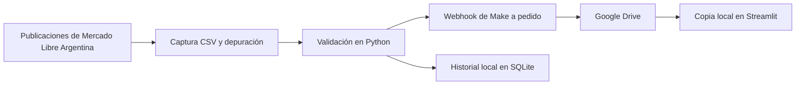

# TACCtico

TACCtico es un proyecto de Capstone B2B para planificar compras de insumos sin TACC. Permite consultar publicaciones de Mercado Libre Argentina, comparar cuánto cuesta cubrir una cantidad con presentaciones enteras y exportar una lista de compras como presupuesto PDF.

## Ejecutar la demo

Con Python 3.12, abrí PowerShell en la carpeta del proyecto y prepará el entorno:

```powershell
python -m venv .venv
.\.venv\Scripts\python.exe -m pip install -r requirements.txt
```

La demo usa el dataset real depurado por Kiara a partir de publicaciones de Mercado Libre Argentina. El [CSV validado](data_public/mercadolibre_validado_2026-11-14.csv) contiene **363 publicaciones únicas**. Los precios corresponden a la captura del **14/11/2026**. Copiá el archivo publicado a la ubicación que lee la app:

```powershell
New-Item -ItemType Directory -Force data_real | Out-Null
Copy-Item -LiteralPath data_public/mercadolibre_validado_2026-11-14.csv -Destination data_real/mercadolibre_validado.csv
```

Iniciá Streamlit desde la raíz del proyecto y mantené abierta la terminal. En macOS o Linux, el intérprete del entorno es `.venv/bin/python`.

```powershell
.\.venv\Scripts\python.exe -m streamlit run app/streamlit_app.py --server.address 127.0.0.1
```

[Abrir la demo local en el navegador](http://127.0.0.1:8501)

1. En **Catálogo**, comprobá que aparezcan 363 publicaciones y filtrá por insumo o título.
2. En **Calculadora de compras → Por cantidad → Peso (kg o g)**, elegí **Polvo hornear**. En **Acotar ofertas → Publicaciones para comparar**, seleccioná `MLA3573151270`, `MLA1824200300` y `MLA3325209494`.
3. Seleccioná gramos. Con `250` debería recomendar la presentación de **ARS 3.509,00**. Con `1.000` debería recomendar la de **ARS 6.639,00** para cubrir 1 kg. Los importes representan la mercadería de la captura.
4. Agregá la oferta a la lista y descargá el PDF. Si el IVA y el envío siguen pendientes, el PDF muestra el **Importe conocido**.

## Esquema del CSV

El archivo está en UTF-8, separado por comas, con una fila por publicación.

| Campos | Uso |
| --- | --- |
| `id_publicacion`, `titulo`, `url`, `fuente` | Identificación, título, enlace original y origen de la publicación. |
| `precio_publicado`, `moneda`, `capturado_en` | Importe publicado en ARS y fecha de captura en UTC con formato ISO 8601. |
| `insumo`, `marca`, `vendedor`, `tipo_vendedor`, `vendedor_id` | Clasificación para buscar y comparar. |
| `gramos_unidad`, `unidades`, `es_pack`, `gramos_totales`, `precio_100g` | Contenido de la presentación y referencia de precio. |
| `fuente_peso`, `peso_discrepa`, `outlier_precio`, `revision_presentacion` | Origen de la medida y alertas de validación. |
| `tiene_promo`, `descuento_pct`, `precio_anterior`, `envio`, `promocion` | Condiciones de referencia en la captura. |
| `categoria`, `nombre_ficha`, `linea`, `sabor`, `rnpa` | Datos complementarios de la ficha del producto. |

Las primeras dos filas de la tabla reúnen las siete columnas obligatorias. Para comparar por peso se necesita el peso total de una presentación válida. Por unidades se necesita la cantidad por presentación. La calculadora excluye los precios atípicos de las recomendaciones automáticas. IVA y envío se anotan en el presupuesto cuando se cuenta con valores confirmados.

## Flujo de datos



La captura del 14/11/2026 tenía 591 publicaciones. La corrida documentada guardó en Drive un CSV con 591 identificadores únicos. La descarga coincidió byte por byte con el CSV validado local. La selección posterior de 363 publicaciones se validó localmente y alimenta la demo. Su nueva carga a Drive queda por verificar. La base SQLite permite guardar varias capturas y Streamlit abre la copia local del CSV.

Apify puede exportar el dataset de una corrida para preparar la captura de entrada. El escenario probado comienza con un CSV ya validado. La bitácora disponible acredita el tramo desde la validación hasta Drive, y la versión de la demo se verifica con el CSV local. [Documentación de exportación en Apify](https://docs.apify.com/platform/storage/dataset)

Para reproducir el tramo de Make con una cuenta propia:

1. Agregá **Webhooks → Custom webhook** y configurá la autenticación por API key. El cuerpo JSON tiene los campos de texto `lote` y `csv_validado`. Pasá la clave mediante el encabezado `x-make-apikey`.
2. Agregá **Google Drive → Upload a File**. Elegí una carpeta de tu cuenta. En el nombre del archivo, combiná `mercadolibre_`, el token `lote` y `.csv`. En **Data** aplicá `toBinary()` al token `csv_validado`.
3. Ejecutá **Run once** y enviá el CSV validado como texto UTF-8 en el campo `csv_validado`. Descargá el resultado de Drive y verificá que su SHA-256 sea igual al del archivo enviado. Si exportás un blueprint para compartir, revisá primero los módulos, valores mapeados y referencias a recursos privados. [Documentación de blueprints de Make](https://help.make.com/blueprints)

## Verificar la instalación

```powershell
.\.venv\Scripts\python.exe scripts/test_purchase_engine.py
.\.venv\Scripts\python.exe scripts/validar_demo.py
```

El primer comando ejecuta casos del motor de compras y presupuesto. El segundo requiere el CSV validado y verifica que el catálogo cargue sus publicaciones y que funcione la búsqueda. En la demo, contrastá el precio por kg con el importe del pedido y descargá el PDF con la misma cantidad seleccionada.

## Fuentes y licencias

- Las publicaciones provienen de Mercado Libre Argentina. El equipo autorizó este CSV validado para acompañar el portafolio del Capstone. El archivo enlaza a cada publicación y conserva su fecha de captura. [Mercado Libre Argentina](https://www.mercadolibre.com.ar/), [Términos del programa de desarrolladores](https://developers.mercadolibre.com.ar/es_ar/es-ar-terminos-y-condiciones)
- Streamlit se distribuye bajo Apache 2.0. Pandas usa BSD de tres cláusulas y ReportLab usa BSD. [Streamlit](https://streamlit.io/terms-of-use), [pandas](https://github.com/pandas-dev/pandas/blob/v2.3.3/LICENSE), [ReportLab](https://pypi.org/project/reportlab/5.1.0/)
- El equipo debe confirmar la licencia de su código antes de agregar un archivo `LICENSE` con permisos de reutilización.
