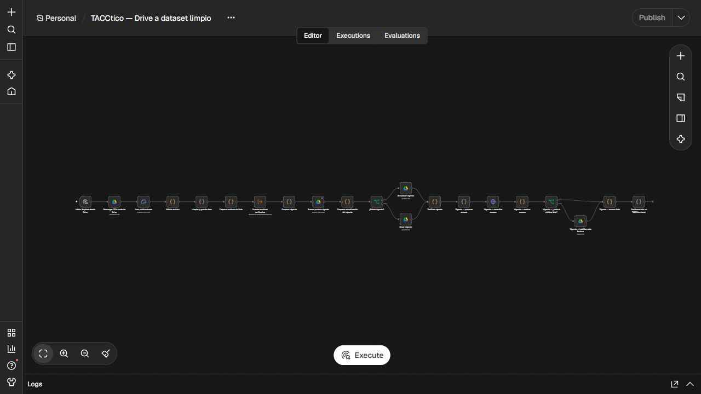

# Entrega de TACCtico: pipeline, modelo y aplicación

Revisión del **23/11/2026** según los puntos del ejemplo docente. [Aplicación pública](https://tacctico-portafolio-ucn4pkoeemkzx9fowx7ktt.streamlit.app/) · [Repositorio público](https://github.com/Tomas-Gonzalez01/tacctico-portafolio).

| Punto | Evidencia entregada |
| --- | --- |
| Arquitectura y flujo | [n8n](../n8n/README.md): Drive crudo → limpieza de Kiara → inferencia local → resultados verificados → Drive → TACCtico. Trigger manual y alternativa por formulario. |
| Repositorio legible | [Mapa de código](CODIGO.md), módulos separados, dependencias, pruebas e instrucciones. |
| Actor propio | [Inferencia](../actor_apify/README.md), fuente, `.actor/actor.json`, Dockerfile, esquemas y modelo entrenado. Construido y ejecutado en Apify. |
| ETL y preparación | Validación de precios, moneda, presentaciones y duplicados; conserva las funciones de Kiara. |
| Entrenamiento | [Código](../scripts/train_ml.py), modelos guardados y notebooks en `colabs/analytics/` y `colabs/training/`. |
| Modelo y alternativas | [Informe ML](MODELO_ML.md): Ridge frente a Random Forest, selección interna, prueba por grupos y baseline. Isolation Forest auxiliar con límites explícitos. |
| Contrato de inferencia | [Entrada y salida](../actor_apify/README.md#entrada-y-salida). El puntaje de anomalía no se presenta como probabilidad. |
| Métricas del modelo | MAE, mediana del error porcentual y R² sobre 55 publicaciones reservadas; predicciones guardadas para comprobarlas. |
| Métricas del negocio | Dashboard de Kiara y escenarios de ROI; no se confunden brechas estimadas con ahorro observado. |
| Costo computacional | Benchmark local y [corrida real de Apify](evidencias/apify-inferencia-20261123.json): CPU, memoria, duración y costo mostrado por consola. |
| Reproducción | [App](../README.md), [n8n](../n8n/README.md), [ML](MODELO_ML.md#reproducir-y-revisar) y [actor](../actor_apify/README.md#ejecutar). |

## Ejecución real del actor

[Actor propio en la cuenta del equipo](https://console.apify.com/actors/vrPmjPvnGdcnclUDA) · [Run verificado](https://console.apify.com/actors/vrPmjPvnGdcnclUDA/runs/j4iEFhMD3Bq6LQha9). Estos enlaces requieren acceso a la cuenta propietaria; el código y los resultados incluidos en GitHub son públicos.

La corrida terminó con éxito, 372 resultados, 335 evaluados, 37 sin evaluar y 17 señales auxiliares. Usó 512 MB asignados, sin GPU. La consola mostró unos 4 segundos totales y USD 0,002, redondeado a tres decimales. La inferencia midió 0,0846 s. El detalle de mediciones no sustituye el gasto histórico del scraping.

## Procedencia del scraping externo

Tomás confirmó el 23/11/2026 que el scraper utilizado por Kiara fue [Mercadolibre Scraper (español castellano), de karamelo](https://apify.com/karamelo/mercadolibre-scraper-espanol-castellano). Su identificador público es `karamelo/mercadolibre-scraper-espanol-castellano`. Quedan documentados el proveedor y el [esquema de entrada](https://apify.com/karamelo/mercadolibre-scraper-espanol-castellano/input-schema).

Todavía no se recibieron la configuración histórica ni el enlace a la ejecución de Kiara. La ficha actual no prueba esos parámetros ni incluye el fuente del scraper en esta entrega. Ver [procedencia y evidencia pendiente](../apify/README.md).

Se entrega íntegramente el código propio de ETL e inferencia, distinto del scraper externo. Si la docente requiere también su fuente, corresponde aclarar la disponibilidad y licencia con el proveedor. El crudo y las credenciales permanecen privados. Juan conserva a su cargo la captura final del dashboard y el video funcional.

## Verificación

Pasaron **73 pruebas de aplicación/ML y 14 de n8n** en ambos repositorios. Cubren presupuesto, IVA, envío, packs, sobrantes, lista, ingesta, historial, integridad, conservación del vigente, validación del modelo, exclusión de presentaciones dudosas, inferencia determinista y equivalencia del JSON portable con scikit-learn sobre las 335 publicaciones. También se comprueba la partición sin grupos compartidos y se recalcula el MAE desde las predicciones reservadas.

El lote publicado conserva **372** publicaciones y **330** en el análisis, y añade **335** evaluaciones ML y **37** casos sin evaluar. La lectura sin cuenta del paquete de Drive pasó su control de integridad.

El mismo flujo fue actualizado con ML el 23/11. Los flujos importables, sus generadores y la conexión con Drive se entregan en [n8n/](../n8n/README.md).
