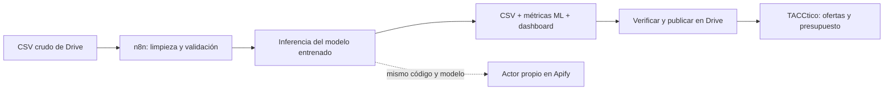

# Modelo entrenado y evaluación de TACCtico

## Función dentro del producto

El flujo conserva la limpieza de Kiara y añade inferencia después de normalizar las publicaciones. La aplicación consulta las señales incluidas en `metricas.json` del mismo lote. El navegador no entrena modelos ni necesita claves. El HTML del dashboard de Kiara y los precios del CSV no se alteran por ML.



La ruta instalada en n8n usa inferencia local en el ejecutor Docker. El actor propio ofrece la misma inferencia en Apify con entrada y salida documentadas. No se afirma que n8n invoque la nube si se usa la ruta local.

## Datos y modelos

- Fuente: CSV validado real de Kiara, captura **14/11/2026**, 372 publicaciones. Se utilizan 335 con precio, moneda y presentación válidos; 37 quedan sin evaluar. No se completan pesos desconocidos con predicciones.
- Isolation Forest aprende una distribución de precio/kg y peso, centrados por insumo, y unidades por presentación. Usa 160 árboles, semilla 42 y un presupuesto operativo de revisión del 5%. Ese 5% no representa una prevalencia conocida de errores.
- La referencia de precio es una regresión supervisada: predice precio/kg desde insumo, marca, peso y cantidad de unidades. No utiliza `precio_publicado`, `precio_100g`, promociones derivadas del precio ni marcas de outlier como entrada de la regresión.
- Se comparan Ridge y Random Forest mediante validación cruzada **solo dentro del entrenamiento**. Se seleccionó Random Forest por menor error logarítmico interno. El modelo final se reajusta con las 335 filas después de la evaluación.

## Evaluación con casos no vistos

Antes de seleccionar modelos se reservó un conjunto por grupos de marca + RNPA/ficha y, si no existen, título normalizado. Así no se mezclan grupos idénticos entre entrenamiento y prueba. La normalización y los vocabularios de cada validación se ajustan solo con su entrenamiento. El conjunto reservado tiene 55 publicaciones y el de desarrollo 280.

| Resultado en la prueba reservada | Random Forest | Mediana por insumo del entrenamiento |
| --- | ---: | ---: |
| Error absoluto medio, ARS/kg | 7.465,53 | 11.824,98 |
| Mediana del error porcentual absoluto | 19,84% | 23,28% |
| R² | 0,527 | -0,166 |

La reducción del MAE frente a la referencia sencilla fue **36,87% en este conjunto**. No se generaliza esa cifra a futuras capturas. El informe conserva los identificadores reservados, predicciones, baseline, versión de bibliotecas y SHA del CSV para comprobar las cuentas.

Para Isolation Forest no hay etiquetas humanas de «precio incorrecto». Por eso **accuracy y precisión reales quedan sin calcular**. Marcó 4 de las 55 ofertas reservadas. En una prueba separada con precios multiplicados por 0,05 o 20 detectó el 39,09% de 110 perturbaciones. Es una limitación del detector, no una precisión comercial. La señal es auxiliar y no descarta publicaciones ni altera el presupuesto. IQR sigue siendo una regla estadística independiente, no una etiqueta verdadera para evaluar ML.

## Reproducir y revisar

Desde la raíz, en PowerShell:

```powershell
.\.venv\Scripts\python.exe -m pip install -r requirements-ml.txt
.\.venv\Scripts\python.exe scripts/train_ml.py
.\.venv\Scripts\python.exe scripts/benchmark_ml.py
.\.venv\Scripts\python.exe -m unittest discover -s scripts -p "test_ml.py"
```

Los modelos y reportes están en `n8n/python/tacctico_etl/models/`: `precios.joblib`, `precios.json`, `metadata.json`, `evaluacion.json`, `prueba_reservada.json` y `benchmark_local.json`. El entrenamiento conserva el objeto original de scikit-learn y exporta sus árboles aprendidos a JSON. La inferencia de producción carga solo ese JSON verificado por SHA, sin deserializar código ni instalar scikit-learn en n8n. Una prueba comprueba que ambos formatos producen los mismos márgenes y referencias sobre las 335 publicaciones. No se deben cargar modelos ejecutables recibidos de terceros. Cambiar el artefacto o el código cambia la huella del lote. La app recibe resultados serializados, no un modelo ejecutable.

Los notebooks de `colabs/analytics/` y `colabs/training/` permiten revisar el análisis y el entrenamiento con el CSV público. No incluyen el crudo ni credenciales. La semilla, la partición y las dependencias se fijan; tiempo y memoria pueden variar entre equipos.

## Consumo y límites

`benchmark_local.json` registra mediciones reales del equipo, separando carga inicial de veinte inferencias posteriores. Informa CPU en segundos y máximo RSS observado entre corridas, no un pico garantizado. No usa GPU. La licencia de n8n local no tiene cargo; electricidad y equipo no se han monetizado.

En Apify hay que registrar el costo y duración del run real. No se usa el gasto acumulado de USD 15 del scraping como costo de inferencia, ni se toman las cifras del ejemplo docente. No se calcula ahorro realizado a partir de una alerta ni se modifica el ROI del dashboard con la supuesta exactitud del modelo.

Los modelos no pronostican precios futuros, no confirman disponibilidad, IVA, envío o aptitud sin TACC y no estiman demanda. El entrenamiento usa una sola captura y una muestra pequeña. La evaluación de anomalías requiere revisión humana independiente antes de utilizarla para bloquear ofertas.

## Fuentes técnicas

- [Isolation Forest, scikit-learn](https://scikit-learn.org/stable/modules/generated/sklearn.ensemble.IsolationForest.html).
- [Validación por grupos, scikit-learn](https://scikit-learn.org/stable/modules/cross_validation.html).
- [Errores habituales y fuga de datos](https://scikit-learn.org/stable/common_pitfalls.html).
- [SDK de Apify para Python](https://docs.apify.com/sdk/python/docs/quick-start).
