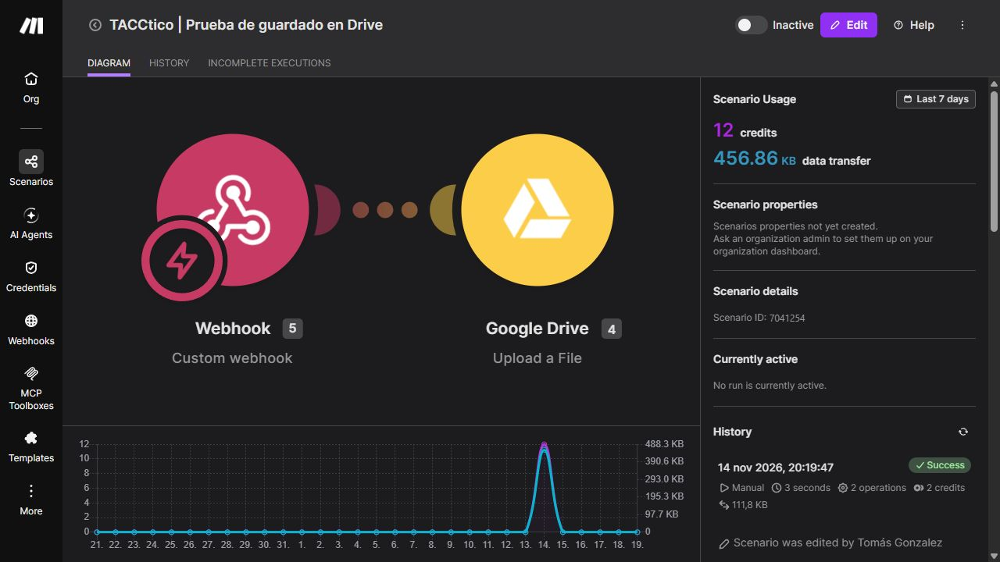

# Make: antecedente de la automatización

El prototipo probado el 14/11/2026 recibía un CSV validado mediante un webhook y lo guardaba en Google Drive. El equipo confirmó la creación del archivo `mercadolibre_2026-11-14_201943.csv`. Después se reemplazó por el [flujo completo de n8n](../n8n/README.md).

El flujo histórico era **Custom webhook → Google Drive / Upload a File**. El nombre se construía con el lote recibido y el contenido usaba `toBinary(csv_validado)`. No se usó Make para volver a scrapear tiendas ni para generar el dashboard actual.

## Evidencia y límites

Captura del editor de Make tomada el **19/11/2026**, sin ejecutar el escenario. El historial muestra la corrida **Success del 14/11/2026 a las 20:19:47**, con dos operaciones y 111,8 KB transferidos. El escenario está **inactivo** y no alimenta el flujo actual.

- La configuración histórica guardada fuera de Git y las URLs de webhook no se publican. Para reutilizar el prototipo se necesitan una conexión propia a Drive y un webhook nuevo.

El [registro de importación anterior](actualizacion_mercadolibre.md) corresponde al lote de 363 publicaciones de esa etapa. El flujo vigente de n8n entrega 372 publicaciones de catálogo y 330 para el análisis, con la captura del 14/11/2026.
