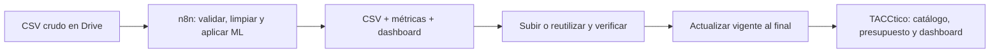

# n8n: del CSV crudo a TACCtico

El flujo principal **TACCtico — Drive a dataset limpio** descarga el archivo crudo de Drive, aplica las funciones ETL de Kiara y entrega un lote completo: catálogo, métricas y dashboard. El flujo auxiliar **TACCtico — Guardar archivo verificado** sube o reutiliza cada archivo y comprueba su integridad.



No se ejecuta scraping en este recorrido. La extracción en Apify aportada por Kiara usó el [scraper externo de karamelo](../apify/README.md); la conexión actual usa el CSV crudo ya disponible. Los precios siguen correspondiendo a su fecha de captura.

## Usarlo en esta computadora

1. Abrí Docker Desktop y esperá a que esté funcionando.
2. En PowerShell, desde la carpeta `n8n`, ejecutá `docker compose up -d`.
3. Abrí [n8n local](http://localhost:5678/workflow/b5d6db94d4354503), flujo **TACCtico — Drive a dataset limpio**.
4. Pulsá **Execute workflow** una sola vez. No ejecutes dos corridas simultáneas.
5. Al terminar, abrí **Confirmar lote en TACCtico local**. Debe indicar `estado: listo` y mostrar el lote y la cantidad de publicaciones.
6. Abrí [TACCtico](https://tacctico-portafolio-ucn4pkoeemkzx9fowx7ktt.streamlit.app/) y pulsá **Actualizar datos**. También podés abrir la demo local desde la raíz del proyecto:

```powershell
.\.venv\Scripts\python.exe -m streamlit run app/streamlit_app.py --server.address 127.0.0.1
```

Si el lote cambió, la app empieza un presupuesto vacío. Si no cambió, conserva tu lista. No hace falta descargar y copiar el CSV a mano. La página sigue disponible con los últimos resultados aunque la computadora de n8n esté apagada.

## Resultado comprobado el 19/11/2026

| Etapa | Publicaciones |
| --- | ---: |
| Entrada válida | 591 |
| Selección útil de Kiara | 347 |
| Catálogo, incluyendo 25 presentaciones sin resolver | 372 |
| Análisis útil sin los 17 precios atípicos | 330 |
| Presentaciones para revisar en el catálogo | 37 |
| Filas rechazadas | 0 |

Se completó una primera subida real con n8n: CSV y paquete ZIP nuevos, verificados por tamaño y MD5 devuelto por Drive. El puntero vigente quedó confirmado. Una repetición reutilizó los mismos archivos. La lectura anónima del puntero y el paquete también pasó el control SHA-256 de la app.

El 23/11/2026 se ejecutó el flujo con la nueva plantilla de ROI y se publicó un lote nuevo. La lectura sin cuenta y la integridad del paquete quedaron verificadas. Los conteos anteriores y el contenido del CSV se mantienen; cambian el dashboard, sus supuestos de ROI y la identidad del lote. La copia de respaldo incluida en GitHub corresponde al mismo resultado de Drive.

El CSV anterior de 363 filas corresponde a otra selección. Las reglas actuales excluyen levadura nutricional y otras premezclas, incorporan dos publicaciones y corrigen dos cajas de chips de 9 kg a 3 kg. No se fuerza un número fijo de salida.

## Qué guarda cada lote

`storage/lotes/<huella>/` conserva entrada normalizada, capturas limpias con historial si existe, selección útil, catálogo validado, rechazos, calidad, métricas, dashboard, paquete y manifiesto con huellas. El lote depende de los datos y de la versión de las reglas. Repetirlo verifica y reutiliza los archivos; un contenido contradictorio se rechaza.

En Drive se guardan dos archivos por lote: `mercadolibre_validado_<lote>.csv` y `tacctico_<lote>.zip`. El ZIP contiene solamente el CSV, `metricas.json`, `dashboard.html`, `calidad.json` y su manifiesto. El archivo fijo `tacctico_vigente.json` referencia ambos resultados y se actualiza después de verificarlos. Los archivos de lotes anteriores permanecen disponibles.

Tomás autorizó lectura pública de esos resultados finales para la demo. La carpeta, el CSV crudo, los rechazos y las credenciales no se comparten públicamente. La configuración instalada comprueba el permiso de lectura y lo crea cuando falta. Los JSON portables omiten esta publicación pública y no incluyen credenciales ni destinos personales.

`storage/publicado.json` confirma el resultado remoto y habilita el mismo lote en la app local. Si la limpieza, integridad o subida falla antes de publicar el puntero, se conserva el vigente anterior. Si se interrumpe la confirmación final, repetir el flujo verifica y termina el mismo lote.

## Métricas y límites

`kiara_etl.py` conserva las funciones del notebook de Kiara y registra su procedencia. `analytics.py` recalcula el análisis del HTML final entregado el 19/11: precio por kg, medianas, dispersión, mejor oferta de hasta 5 kg y ejemplos de pan, pizza y budín. El diseño y las interacciones del HTML se mantienen en `templates/dashboard_kiara.html`.

Las brechas frente a la mediana son estimaciones, no ahorro observado. Recetas, frecuencias, tiempos y valores por hora son supuestos editables; no se presentan las referencias salariales del equipo como valores oficiales vigentes. Con una sola captura no se calcula una tendencia. El presupuesto verifica presentaciones y cargos para una compra concreta y no inventa IVA, envío ni promociones.

El ROI del dashboard usa solo el ahorro anual estimado en compras y el costo anual de datos; el tiempo queda separado. Los valores iniciales (USD 15 por actualización, 12 al año, ARS 1.701 por USD) son referencias editables del equipo, no tarifas ni cotizaciones verificadas. Los USD 15 representan gasto acumulado con pruebas utilizado como supuesto por actualización. No se incluyen otros costos no cuantificados. El costo anual de referencia es ARS 306.180; con costo cero no se calcula un porcentaje de ROI. `analytics.py` exporta estos supuestos a las métricas y a la plantilla.

Al cambiar las reglas, las métricas o la plantilla hay que reconstruir los ejecutores con `docker compose up -d --build task-runners` y ejecutar el flujo. Se crea un lote nuevo aunque el CSV sea idéntico; no se modifica el HTML ni su huella dentro de un lote anterior. La publicación verifica el paquete y actualiza el vigente al final.

## Instalación nueva

Requiere Docker Desktop funcionando con Linux/WSL 2. Desde esta carpeta:

```powershell
python preparar_entorno.py
docker compose up -d --build
```

El primer comando genera una clave interna aleatoria en `.env` sin sobrescribir la existente. n8n y los ejecutores usan la versión 2.48.5; pandas y NumPy están fijados en `requirements-python.txt`. Los ejecutores solo tienen permisos de escritura en `/files`; el editor monta esa carpeta en lectura. El editor escucha únicamente en `127.0.0.1:5678`.

Creá tu usuario local y [conectá tu propio Drive](CONECTAR_DRIVE.md). No requiere n8n Cloud ni una cuenta de Docker. El volumen `tacctico_n8n_data` conserva cuenta, clave de cifrado, conexiones y flujos. Respaldalo junto a `storage/`; no uses `docker compose down -v`.

Importá primero `flujo_publicador_plantilla.json` y después `flujo_drive_plantilla.json`. Seleccioná la conexión Google en los nodos Drive, el archivo de entrada, la carpeta de salida y el ID del subflujo. La lectura pública requiere autorización del equipo y configuración explícita; las plantillas no la activan. `flujo_dataset_limpio.json` conserva la alternativa de carga por formulario local.

### Regenerar las plantillas

Desde `n8n/`, estos comandos funcionan en un clon público nuevo, sin credenciales ni archivos de `backups/`:

```powershell
python generar_flujo.py
python generar_publicacion.py
```

El primero genera la alternativa por formulario. El segundo genera las dos plantillas del recorrido principal de Drive. Ambos admiten `--output-dir RUTA` para comprobar los resultados en otra carpeta. Importar sus funciones no escribe archivos, y ninguno modifica las reglas ETL ni el lote publicado. `generar_flujo_drive.py` contiene funciones auxiliares; no se ejecuta como un generador separado.

Para preparar una instalación propia desde un archivo privado existente:

```powershell
python generar_publicacion.py --config backups/drive_destinos.json
```

La configuración debe contener `workflow_id`, `archivo_crudo` y `carpeta_salida`. Se conserva o genera `publicador_id`; `acceso_publico` es opcional y queda desactivado por defecto. El resultado configurado se guarda como `flujos_publicacion.json` junto a la configuración privada. Las plantillas públicas conservan destinos de ejemplo. Las conexiones se seleccionan dentro de n8n; solo si se necesita reutilizar una exportación privada, se indica explícitamente `--credentials-from backups/mi_exportacion.json`. No subas esos archivos a GitHub.

Para detener y volver a iniciar sin borrar datos:

```powershell
docker compose stop
docker compose up -d
```

La conexión Google externa está en modo de prueba y puede requerir renovarse después de siete días. No se habilitó facturación ni se expuso n8n a Internet. `.env`, `storage/`, `backups/`, CSV crudos y credenciales están excluidos de Git y de la imagen Docker. Los registros de n8n se depuran después de siete días; los lotes no.

## Verificación

Desde la raíz del repositorio:

```powershell
.\.venv\Scripts\python.exe -m unittest discover -s n8n -p "test_*.py"
.\.venv\Scripts\python.exe -m unittest discover -s scripts -p "test_*.py"
.\.venv\Scripts\python.exe scripts/validar_demo.py
```

Los casos de control comprueban captura, moneda, pesos y packs, historial, duplicados, rechazos, publicación por etapas, archivos permitidos, integridad, cambio de versión y conservación del presupuesto si la actualización falla. Los datos artificiales se limitan a las pruebas; la app muestra los datos reales.

## Inferencia ML incorporada el 23/11

El ejecutor utiliza los árboles entrenados y verificados después de la limpieza, sin reentrenar en cada corrida. Añade señales a metricas.json y conserva el CSV y el HTML de Kiara. El mismo código se ofrece como actor propio en Apify. Ver [modelo y evaluación](../docs/MODELO_ML.md) y [contrato del actor](../actor_apify/README.md). La ruta instalada usa inferencia local y no necesita un token de Apify para actualizar la web.
